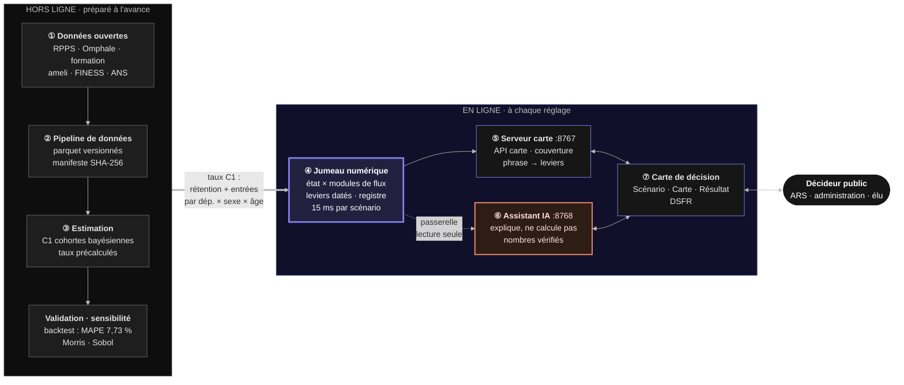

# Architecture du jumeau numérique de l'offre de soins

> Schéma d'ensemble et rôle de chaque brique. Périmètre au 2026-11-15 : sorties au **département** (puis région,
> national), horizon 2050, secteur privé des sages-femmes, dentistes, pharmaciens, kinés et infirmiers.

## Les briques

### 1 · Données ouvertes

Uniquement des données publiques. Chaque entrée cite son producteur et son millésime.

| Donnée | Producteur | Période | Usage |
|---|---|---|---|
| Démographie des professionnels de santé (RPPS) | DREES | 2012-2026 (kinés : 2017-2026) | stock et taux |
| Projections de population Omphale 2022, 3 scénarios | Insee | 2018-2070 | densités |
| Diplômés et inscrits en formation | DREES | 1966-2025 | vivier d'entrants |
| ameli, FINESS, Annuaire Santé (ANS), CartoSanté | Assurance Maladie, Ministère, ANS, ARS | 2004-2026 | public / privé, contrôles croisés |
| Projections DREES (Dossier n°76, ER 1319) | DREES | 2021-2050 | comparaison à long terme |

Liste complète : `README.md`, section *Données et méthode*.

### 2 · Pipeline de données (`v2/data/`)

Les scripts `build_*.py` transforment les fichiers bruts (≈ 3,6 Go, non versionnés) en parquet traités
(≈ 37 Mo, versionnés dans `data/processed/`). Le manifeste d'empreintes SHA-256 garantit que tout le monde travaille
sur les mêmes données : `uv run python v2/data/manifest.py --check`.

### 3 · Estimation, hors ligne

Ces calculs tournent à l'avance, pas pendant la démo.

- **`v2/sante/`** : chargeurs des données de base et estimateurs de référence (tendance, stock-flux).
- **`v2/methodes/`** : ajustement de **C1**, le modèle par cohortes bayésien hiérarchique (voir ci-dessous).
- **`v2/validation/`** : backtest selon des protocoles pré-enregistrés et gelés. MAPE départementale à 5 ans
  (secteur privé, mesurée) : 7,73 % pour C1, 8,68 % pour le stock-flux, 9,30 % pour la tendance.
- **`v2/sensibilite/`** : méthodes Morris puis Sobol, pour savoir quels paramètres déplacent l'effectif de 2050.

#### Les « taux C1 », ce que le jumeau reçoit

Le jumeau ne réestime rien pendant la démo. Il lit, pour chaque profession, deux tableaux précalculés
(`v2/methodes/out/c1_taux/<profession>.npz`). Chaque ligne est une cellule département × sexe, et chaque colonne
une tranche d'âge de 5 ans.

| Taux | Ce qu'il dit | Comment il est estimé |
|---|---|---|
| **Rétention** `s` | la part des professionnels d'une cellule qui restent en exercice au pas suivant ; le complément, ce sont les sorties (retraite, départ, changement de secteur) | modèle âge-période-cohorte des sorties |
| **Entrées** `i` | le nombre d'entrants par an dans la cellule, surtout dans les tranches jeunes ; c'est un flux absolu, pas un taux appliqué au stock, pour éviter le double comptage | total national suivi par un filtre de Kalman, puis réparti entre départements |

**Pourquoi « bayésien hiérarchique ».** Un petit département a peu d'observations, donc un taux estimé seul serait
bruité. Le modèle le tire vers celui de sa région, puis vers le niveau national, d'autant plus fort que ses données
sont rares. Avec ce lissage, l'âge-période-cohorte et le filtre de Kalman, C1 obtient 7,73 % de MAPE, contre 8,68 %
pour le stock-flux à taux locaux bruts. La part de chaque ingrédient dans ce gain n'a pas été isolée.

**Comment le jumeau s'en sert.**
- Les taux C1 remplacent les taux bruts du stock-flux pour le **secteur privé** seulement ; le public garde les taux
  observés (`v2/methodes/c1_jumeau.py`).
- Les **leviers s'appliquent par-dessus** : « +20 % de places en formation » multiplie les entrées C1, à partir de
  l'année de décision + la durée des études.
- La rétention est tenue à sa moyenne sur l'horizon de projection. C'est une approximation, et l'écart qu'elle crée
  sur le total national est mesuré.
- Chaque fichier porte l'empreinte SHA-256 des données d'origine. Si elles changent, les taux sont réajustés, à raison
  de 10 à 20 s par profession.

### 4 · Jumeau numérique (`v2/jumeau/`)

Le cœur du système :

- un **état** unique, qui suit les effectifs par profession × secteur × territoire × sexe × âge (`state.py`) ;
- un **moteur** qui, chaque année, appelle les **modules de flux** sous forme de plug-ins (`engine.py`, `modules/`) ;
- un **registre** qui garde chaque flux, ce qui permet de décomposer tout écart au tendanciel (entrées, sorties,
  régulation) ;
- des **leviers** qui sont des événements datés (`scenario.py`). Exemple : « places × 1,2 à partir de l'année de
  décision + la durée des études ». Un scénario s'enregistre en JSON et se rejoue à l'identique.

Les taux de C1 remplacent ceux du stock-flux pour le secteur privé (`v2/methodes/c1_jumeau.py`). Tous les leviers
gardent leur mécanisme. Le jumeau calcule un scénario en 15 ms au département. 18 critères d'acceptation le
vérifient : `PYTHONPATH=v2 uv run python -m jumeau.check`.

### 5 · Serveur de la carte (`v2/prototype-carte/server.py`, port 8767)

Il expose le jumeau en HTTP, en s'appuyant sur `v2/prototype/server.py` (modèle, leviers et leurs bornes) :

| Route | Rôle |
|---|---|
| `/geo` | contours des départements |
| `/api/carte` | valeurs 2026 et 2050 par département, en tendanciel et en scénario |
| `/api/couverture` | indice de couverture |
| `/api/interpret` | phrase → réglage des leviers, par le compilateur déterministe de `v2/langage/` (traduit, ne calcule rien) |
| `/api/agent` | relais vers l'assistant |

### 6 · Assistant (`chatbot/`)

Il fonctionne en deux processus, avec une seule porte d'accès au modèle :

- **chat** (port 8768) : Claude Haiku interprète la question et rédige la réponse. Chaque nombre cité est vérifié
  contre le jumeau, et le lexique neutre est contrôlé (`v2/agent/garde_fous.py`).
- **passerelle** (port 8770) : c'est le seul processus qui charge le modèle. Elle accepte une liste blanche de
  8 requêtes, en lecture seule.

**L'IA explique les résultats, elle ne calcule rien et ne peut rien modifier.** Sans clé API, le glossaire de
l'équipe prend le relais. L'assistant est la porte d'entrée prévue pour le persona élu.

### 7 · Carte de décision (`v2/prototype-carte/index.html`)

L'interface, en DSFR, en trois colonnes :

- **Scénario** : les leviers, regroupés par familles ;
- **Carte** : les départements ;
- **Résultat** : l'effectif, l'écart au tendanciel, la densité, la fourchette, la pyramide des âges et l'écart
  décomposé par flux.

S'y ajoutent l'export CSV (sources, millésimes, hypothèses, version du code) et un mode expert.

## En résumé

1. **Les données sont ouvertes et versionnées.**
2. **Le modèle est une boîte blanche, estimée hors ligne et backtestée.**
3. **Le jumeau est rapide, rejouable et explique chaque écart par ses flux.**
4. **L'IA est confinée à l'explication des résultats.**
